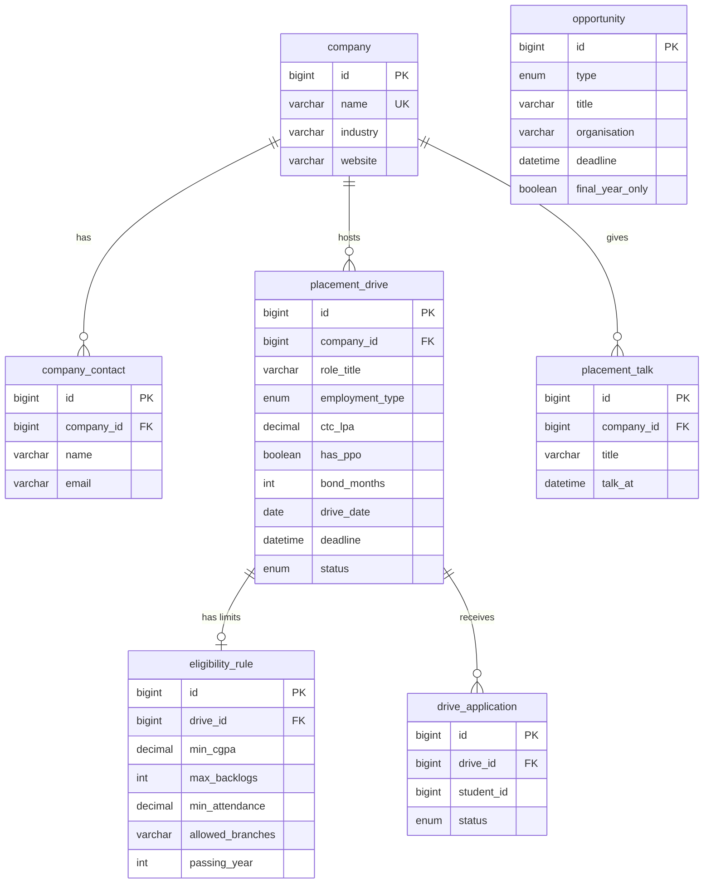

# ER diagram: Drives and Opportunities (owner: Aliza)

Notes:
- `student_id` in drive_application points to the student table owned by Surendra. It becomes a real link when his tables land.
- Rounds (`drive_round`) and candidate status belong to Ashish and will join this diagram when his tables land.
